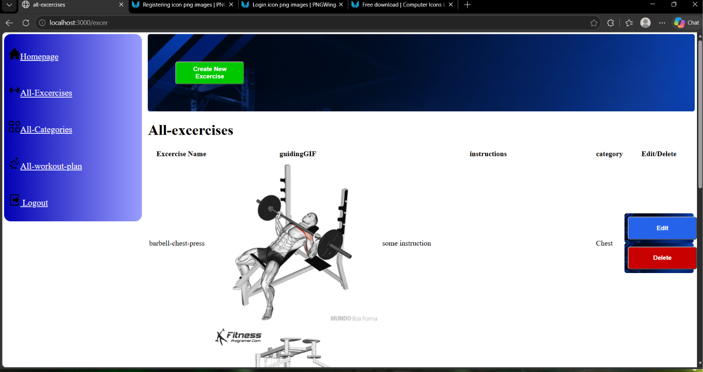
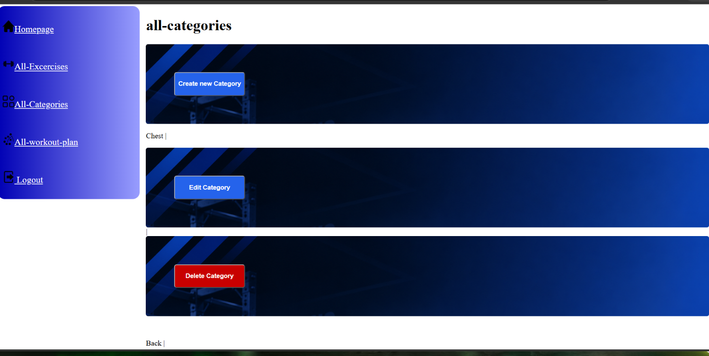
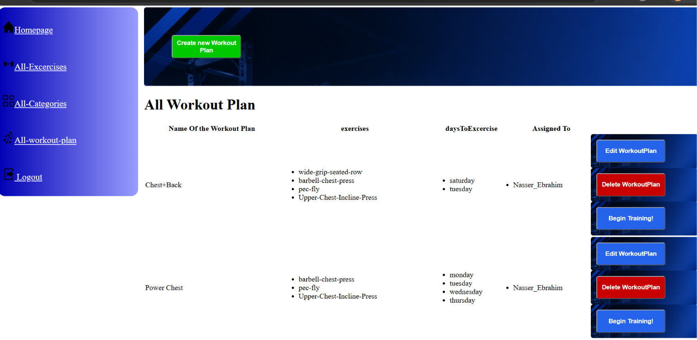
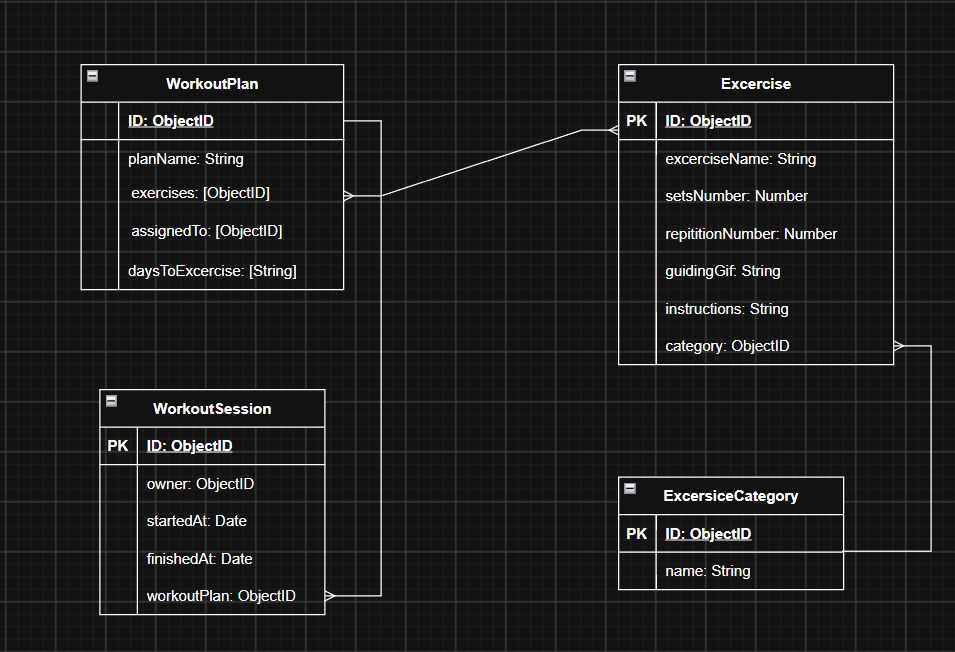

# Project Name
Smart Fitness App

## Overview
the app will help the user to memorize the steps of his excercise

## Screenshots

## Technologies Used
Visual Studio Code:
- HTML
- CSS
- JAVASCRIPT
- NODE.js
- EXPRESS package
- MONGOOSE package
- MONGO DataBase
- EJS package

## Getting Started

## User Stories
- the user can create a workout plan
- the user can delete a workout plan
- the user can update a workout plan
- the user can view all workout plan
- the user can create a excersise 
- the user can update a excersise 
- the user can manage the category
- the user can make custom workout plan for his requirement
- the user can see the workout instruction in gif format

## Database Design

## Routes

| Method | Route | Description |
|---------|-------|-------------|
| GET | / | Home page |
| GET | /excer | List all Exercises |
| GET | /excer/new | New Exercise form |
| POST | /excer/new | Create exercise |
| GET | /excer/:id/edit | Edit exercise form |
| PUT | /excer/:id | Update exercise |
| DELETE | /excer/:id | Delete exercise |
|---------|----------|------------|
| GET | /excercat | List all category |
| GET | /excercat/new | New category form |
| POST | /excercat/new | Create category |
| GET | /excercat/:id/edit | Edit category form |
| PUT | /excercat/:id | Update category |
| DELETE | /excercat/:id | Delete category |
|----------|----------|-------------|
| GET | /workplan | List all category |
| GET | /workplan/new | New category form |
| POST | /workplan/new | Create category |
| GET | /workplan/:id/edit | Edit category form |
| PUT | /workplan/:id | Update category |
| DELETE | /workplan/:id | Delete category |
|----------|----------|-------------|

## Features

- manage Categories (crud)
- manage Exercise (crud)
- manage WorkOut Plan (crud)
- User Management (registration,login)

## Future Enhancements
- admin dashboard
- recording progress
- analyze the progress data

## Credits
- Mr zaid
- Ms aya
- Mr omar